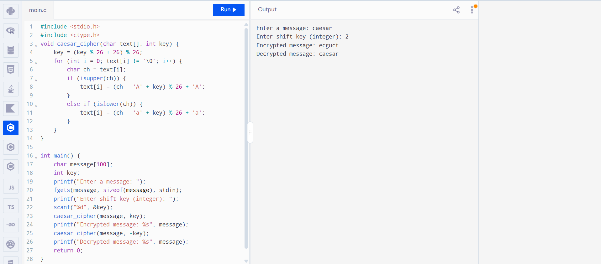

# EX. NO: 1(A) : IMPLEMENTATION OF CAESAR CIPHER

## AIM:
To implement the simple substitution technique named Caesar cipher using C language.

## ALOGORITHM:

STEP-1: Read the plain text from the user.

STEP-2: Read the key value from the user.

STEP-3: If the key is positive then encrypt the text by adding the key with each character in the plain text.

STEP-4: Else subtract the key from the plain text.

STEP-5: Display the cipher text obtained above.

## PROGRAM:

```
#include <stdio.h>
#include <ctype.h>
void caesar_cipher(char text[], int key) {    
    key = (key % 26 + 26) % 26;
    for (int i = 0; text[i] != '\0'; i++) {
        char ch = text[i];
        if (isupper(ch)) {
            text[i] = (ch - 'A' + key) % 26 + 'A';
        }
        else if (islower(ch)) {
            text[i] = (ch - 'a' + key) % 26 + 'a';
        }
    }
}

int main() {
    char message[100];
    int key;
    printf("Enter a message: ");    
    fgets(message, sizeof(message), stdin);
    printf("Enter shift key (integer): ");
    scanf("%d", &key);   
    caesar_cipher(message, key);
    printf("Encrypted message: %s", message);
    caesar_cipher(message, -key);
    printf("Decrypted message: %s", message);
    return 0;
}

```

## OUTPUT:



## RESULT :
 Thus the implementation of ceasar cipher had been executed successfully.
